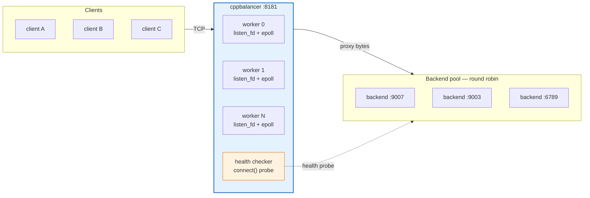
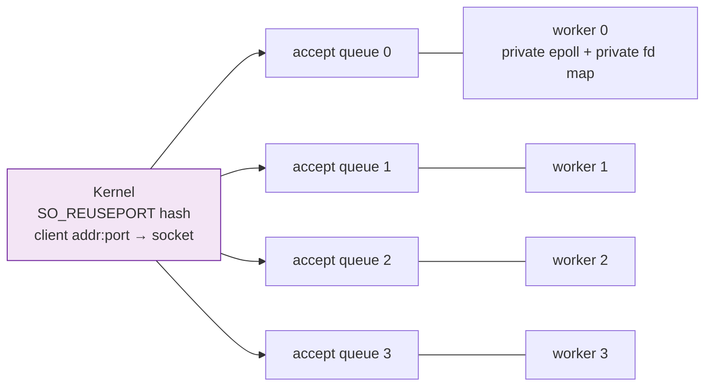
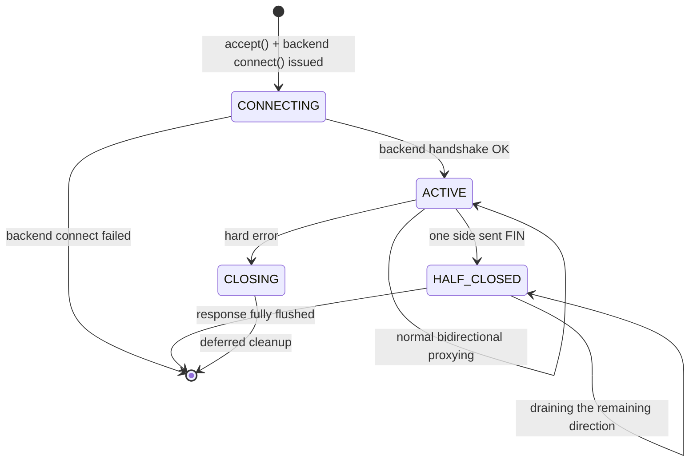
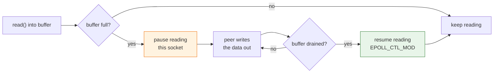

# ⚡ cppbalancer

A high-performance, non-blocking TCP/HTTP load balancer written in modern C++17. Built from scratch using Linux `epoll`, edge-triggered I/O, and a multi-threaded `SO_REUSEPORT` worker pool — no frameworks, no dependencies.



> 📖 **[Full architecture walk-through → `docs/architecture.md`](docs/architecture.md)** —
> thread model, the `SO_REUSEPORT` pool, the epoll event loop, the connection
> state machine, the buffer and backpressure design, and a byte-by-byte trace
> of a request.

---

## 📊 Benchmark results (headline)

**Measured on an Intel® Xeon® @ 2.20 GHz — 2 physical cores / 4 logical CPUs, 31 GiB RAM, Ubuntu 24.04, all traffic over loopback.**
Full methodology, environment capture, raw data and analysis:
**[`benchmark/README.md`](benchmark/README.md)**.

| Metric | Direct to backend (control) | Through `cppbalancer` |
|---|---|---|
| **Peak throughput** (1 KiB bodies, 100 conns) | 95,831 req/s | **44,862 req/s** (48.5 MB/s) |
| **Peak throughput** (1 MiB bodies) | — | **1,054 req/s** (1,053 MB/s) |
| **Latency**, 1 idle connection (p50) | 0.0494 ms | 0.1079 ms (**+0.058 ms**) |
| **Latency**, 1 idle connection (p99) | 0.1110 ms | 0.2356 ms (+0.125 ms) |
| **Connection churn** (new conn per request) | 4,283 conn/s | 3,851 conn/s (−10 %) |
| **CPU cost** | — | 42 µs CPU/request (1.89 cores at peak) |
| **Memory** | — | 5.0 MB RSS @ 100 conns, 8.8 MB @ 500 |
| **Worker scaling** (1 → 2 workers) | — | 26,007 → 39,994 req/s (**1.54×**) |
| **Failover** (1 of 3 backends killed) | — | 42,195 → 44,240 req/s (**no loss**) |
| **Round-robin fairness** | — | 122 / 121 / 121 over 3 backends (**exact**) |

---

## What it does

`cppbalancer` sits in front of a pool of backend servers and distributes incoming TCP connections across them. It proxies raw bytes bidirectionally, handles partial writes, graceful half-closes, backend failover and backpressure — all without blocking a thread.

---

## Architecture

> The complete design — thread model, event dispatch, buffer mechanics and a
> byte-by-byte request trace — is documented in
> **[`docs/architecture.md`](docs/architecture.md)**. This section is the
> summary.

### Worker pool (`SO_REUSEPORT`)



The main function spawns one worker thread per CPU core. Each thread binds its
own `listen_fd` to port `8181` using `SO_REUSEPORT`, so the OS kernel
load-balances `accept()` calls across workers with no userspace coordination.
No mutex. No shared accept queue. Pure parallelism.

Because each worker owns **both** ends of every connection it handles, a
connection is never touched by two threads — there is no lock anywhere on
the data path.

### Epoll event loop (edge-triggered)

Each worker runs its own `epoll` instance. All sockets are `O_NONBLOCK`.
Client and backend fds are both watched with `EPOLLET` (edge-triggered) for
efficiency — the loop only wakes up when new data actually arrives.

> **Why not level-triggered everywhere?**
> The `listen_fd` uses level-triggered (`EPOLLIN` without `EPOLLET`)
> intentionally. Edge-triggered on a listen socket can silently drop
> connections under burst load when a wakeup is missed.

### Connection state machine



| State | Description |
|---|---|
| `CONNECTING` | Backend TCP handshake in progress; client data is buffered in `c2b_buf` |
| `ACTIVE` | Both sides open; full bidirectional proxy |
| `HALF_CLOSED` | One peer sent FIN; draining the other direction before teardown |
| `CLOSING` | Deferred cleanup at end of event loop iteration |

### Bidirectional buffering

Each `Connection` owns two fixed-size buffers:

- `c2b_buf` — data from **client → backend** (64 KiB)
- `b2c_buf` — data from **backend → client** (64 KiB)

`append_to_buffer(fd, ...)` and `try_write(fd)` are intentionally symmetric —
the same logic handles both directions. `EPOLLOUT` is only armed when there's
buffered data to flush, and de-armed immediately after, keeping the epoll
set clean.

### Backpressure (no silent truncation)

A read is only issued for as many bytes as the destination buffer can
actually hold. When that buffer fills up, reading from the source socket is
**paused** and resumed (via `EPOLL_CTL_MOD`) once the peer has drained the
buffer. The current epoll interest mask of each socket is tracked so that
re-arming for reading never clears a pending `EPOLLOUT`.



Details: [`docs/architecture.md` §8](docs/architecture.md#8-backpressure--the-pauseresume-mechanism).

### TCP_NODELAY
Both client and backend sockets have Nagle's algorithm disabled. Without this, the kernel holds small writes (e.g. a lone HTTP status line) until an ACK arrives — adding ~40 ms latency even on loopback and making browsers time out waiting for headers.

### Health checker
A background thread probes every backend with a real TCP `connect()` every `--health-interval` seconds. Unhealthy backends are atomically marked and skipped during routing. Round-robin selection walks the list and finds the next healthy backend.

---

## Build & run

### Requirements
- Linux kernel ≥ 3.9 (for `SO_REUSEPORT`)
- GCC ≥ 9 or Clang ≥ 10
- C++17

### Compile

```bash
g++ -O2 -std=c++17 -pthread -o cppbalancer cppbalancer.cpp
# or
make
```

### Run

```bash
./cppbalancer
# Workers start on port 8181, one per CPU core
```

### Configure

Everything is configurable at start-up — the defaults reproduce the original
hard-coded behaviour exactly.

```
Usage: cppbalancer [options]

  --listen-port <port>      Port the balancer listens on            (default 8181)
  --backends <ip:port,...>  Comma separated backend pool            (default 127.0.0.1:9007,127.0.0.1:9003,127.0.0.1:6789)
  --workers <n>             Number of worker threads               (default: hardware concurrency)
  --health-interval <sec>   Backend health-check interval in sec    (default 5)
  --quiet                   Suppress per-connection logging        (default: logging on)
  --help                    Show this help
```

The same settings are available as environment variables
(`CPPBALANCER_LISTEN_PORT`, `CPPBALANCER_BACKENDS`, `CPPBALANCER_WORKERS`,
`CPPBALANCER_HEALTH_INTERVAL`, `CPPBALANCER_QUIET`); command-line options win.

```bash
./cppbalancer --backends 10.0.0.5:8080,10.0.0.6:8080 --listen-port 80 --workers 2 --quiet
```

> **Tip:** run with `--quiet` in production. The per-connection log line costs
> several `write(2)` syscalls on the accept path, which is invisible for
> keep-alive traffic but measurable under connection churn (see
> [§7.7 of the benchmark report](benchmark/README.md#77-s7--cost-of-the-per-connection-logging)).

---

## Project structure

```
.
├── cppbalancer.cpp          # the implementation (backends, state machine, worker pool, health checker)
├── Makefile                 # build / test / benchmark helpers
├── README.md                # this file
│
├── docs/                    # design documentation
│   └── architecture.md      # detailed walk-through: threads, epoll, state machine,
│                             # buffers, backpressure, request trace, cost model
│
├── archive/                 # superseded code, kept for history — see archive/README.md
│   ├── loadbalancer_round_robin.cpp    # the original single-threaded balancer
│   └── README.md
│
├── benchmark/               # the benchmark suite — see benchmark/README.md
│   ├── README.md            # methodology, environment, progress log, results, analysis
│   ├── run_benchmarks.sh    # orchestrator: runs all 11 scenarios
│   ├── backends/http_backend.c        # fast C origin server used by the suite
│   ├── baseline/cppbalancer_prefix.cpp # pre-fix balancer, for the S11 A/B comparison
│   ├── tools/               # wrk script, CPU sampler, latency probe, churn client,
│   │                        # integrity verifier, results analyzer
│   └── results/             # raw output of the recorded run (env.txt, wrk logs, CPU samples)
│
└── test/                    # interactive smoke tests — see test/README.md
    ├── test_client.py       # connect to the balancer, send a message, print the echo
    ├── test_server.py       # minimal echo backend
    └── README.md
```

---

## Key design decisions & tradeoffs

| Decision | Reasoning |
|---|---|
| `epoll` over `select`/`poll` | O(1) event delivery regardless of fd count; essential for high connection counts |
| Edge-triggered I/O | Fewer wakeups under load; requires draining loops but reduces syscall overhead |
| `SO_REUSEPORT` multi-thread | Eliminates the thundering-herd problem of a shared accept queue; each core is independent |
| One worker owns both ends of a connection | No fd hand-off between threads ⇒ **no lock on the data path** |
| Fixed-size stack buffers | Avoids heap allocation per connection; predictable memory layout |
| **Pause/resume instead of truncate** | A read is only issued for bytes that fit; large responses are streamed, never corrupted — see [`docs/architecture.md` §8](docs/architecture.md#8-backpressure--the-pauseresume-mechanism) |
| `TCP_NODELAY` on both sides | Eliminates Nagle-induced latency for HTTP and other request-response protocols |
| Deferred `close_connection()` | Avoids freeing `conn` mid-event-loop iteration and using a dangling pointer |
| Level-triggered listen fd | Safer under accept bursts; edge-triggered listen can miss connections |

> Each of these is explained in detail — with diagrams — in
> [`docs/architecture.md`](docs/architecture.md).

---

## Limitations & future work

- **Round-robin only** — no weighted, least-connections, or consistent-hash routing
- **No TLS** — termination would require OpenSSL/BoringSSL integration
- **No config file / hot reload** — backends are set via CLI or environment variables, but there is no live reload
- **Fixed 64 KiB buffers** — large payloads are streamed correctly, but a larger buffer would reduce the syscall count for big responses (see [§7.6](benchmark/README.md#76-s6--payload-size-sweep-50-connections-2-wrk-threads) of the benchmark report)
- **No observability** — no metrics endpoint; the internal counters are not yet exposed
- **Health-check window** — a backend that dies is only detected at the next health-check tick (default 5 s); requests routed to it in that window fail

---

## License

MIT
