# Architecture of `cppbalancer`

> A detailed walk-through of how the load balancer is built and how a single
> byte travels through it.
>
> **Source of truth:** [`cppbalancer.cpp`](../cppbalancer.cpp) (~600 lines).
> **Measured behaviour:** [`benchmark/README.md`](../benchmark/README.md).

---

## Table of contents

1. [Design goals](#1-design-goals)
2. [The big picture](#2-the-big-picture)
3. [Threads and their responsibilities](#3-threads-and-their-responsibilities)
4. [The `SO_REUSEPORT` worker pool](#4-the-soreuseport-worker-pool)
5. [The epoll event loop](#5-the-epoll-event-loop)
6. [The connection state machine](#6-the-connection-state-machine)
7. [Buffers and the two data directions](#7-buffers-and-the-two-data-directions)
8. [Backpressure — the pause/resume mechanism](#8-backpressure--the-pauseresume-mechanism)
9. [A complete request, end to end](#9-a-complete-request-end-to-end)
10. [Half-close handling](#10-half-close-handling)
11. [Backend selection: round robin](#11-backend-selection-round-robin)
12. [Health checking and failover](#12-health-checking-and-failover)
13. [Memory model and thread safety](#13-memory-model-and-thread-safety)
14. [Configuration](#14-configuration)
15. [Failure modes and how they are handled](#15-failure-modes-and-how-they-are-handled)
16. [Cost model — where the time goes](#16-cost-model--where-the-time-goes)

---

## 1. Design goals

| Goal | How the design achieves it |
|---|---|
| **Never block a thread** | Every socket is `O_NONBLOCK`; one `epoll_wait()` per worker drives everything. |
| **No lock on the data path** | Each worker owns *both* ends of every connection it handles, so a connection is never touched by two threads. There is no mutex anywhere in the request path. |
| **Scale with cores** | One worker per core, each with its own listen socket (`SO_REUSEPORT`), so the kernel distributes accepts without a shared queue. |
| **Never corrupt the stream** | A read is only issued for bytes that fit in the destination buffer; reading pauses instead of truncating. |
| **No dependencies** | Only libc and Linux `epoll`. No Boost, no libevent, no OpenSSL. |

---

## 2. The big picture

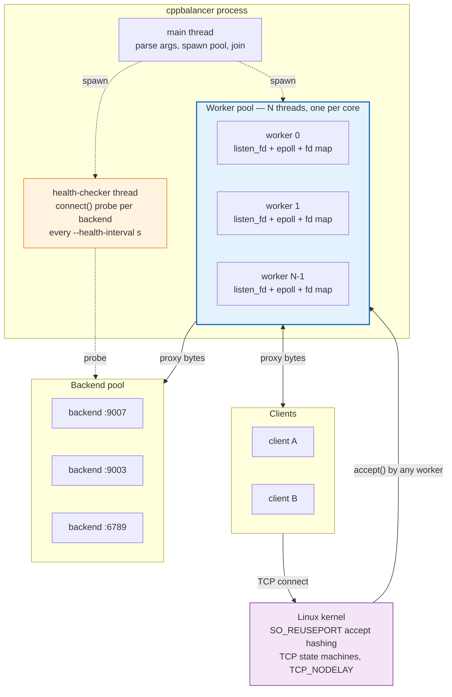

**Three kinds of threads, three different jobs:**

| Thread | Count | Owns | Blocking? |
|---|---|---|---|
| `main` | 1 | argument parsing, spawning, joining | Only on `join()` |
| **worker** | N = `hardware_concurrency()` | its own `listen_fd`, its own `epoll` instance, its own `fd → Connection*` map | Never — `epoll_wait(-1)` sleeps until an event |
| **health-checker** | 1 | the `Backend` health flags | Yes, deliberately — it sleeps 5 s between probe rounds |

---

## 3. Threads and their responsibilities

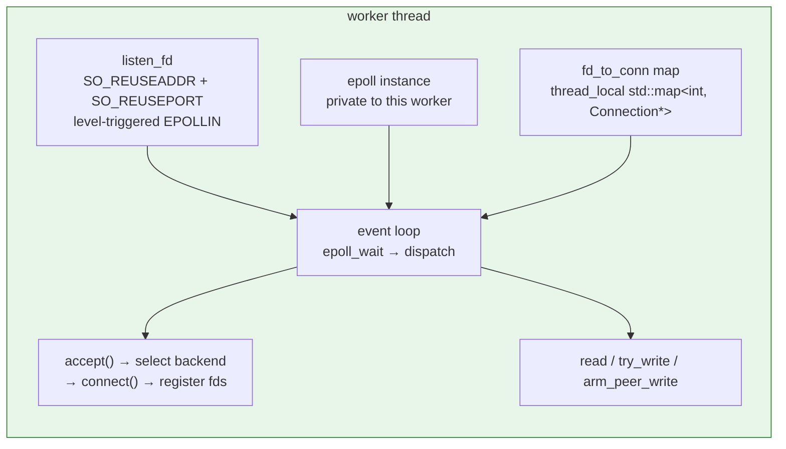

The critical property: **`fd_to_conn` is `thread_local`**. A connection accepted
by worker 3 is only ever looked up, read from, written to and closed by
worker 3. That is why there is no mutex and no work-queue hand-off between
threads — the cost of proxying a connection is paid entirely inside one core.

```cpp
void worker_thread() {
    thread_local std::map<int, Connection*> fd_to_conn;   // <-- private to this thread
    ...
}
```

---

## 4. The `SO_REUSEPORT` worker pool

Each worker creates its **own** listening socket on the same port:

```cpp
int listen_fd = socket(AF_INET, SOCK_STREAM, 0);
setsockopt(listen_fd, SOL_SOCKET, SO_REUSEADDR, &opt, sizeof(opt));
setsockopt(listen_fd, SOL_SOCKET, SO_REUSEPORT,  &opt, sizeof(opt));
bind(listen_fd, (sockaddr*)&addr, sizeof(addr));   // same port, same address
listen(listen_fd, 1024);
```

The kernel keeps one accept queue per socket and hashes the 4-tuple of each
incoming connection to pick the socket that will receive it. The result:

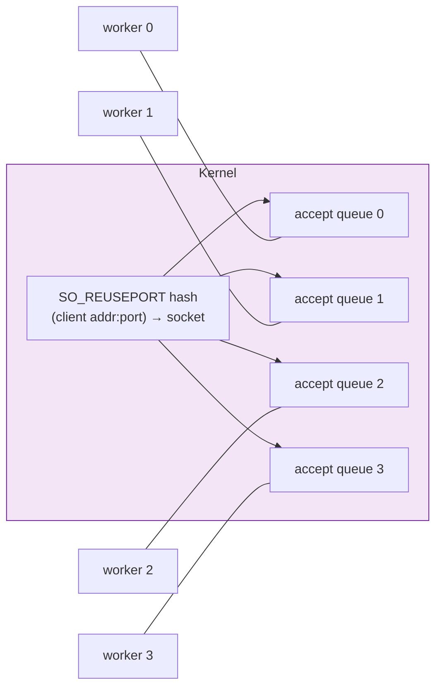

**Compared with the classic "one shared listen socket" design:**

| | shared accept queue | `SO_REUSEPORT` (this design) |
|---|---|---|
| `accept()` contention | All workers wake on one queue → thundering herd | Each worker has a private queue |
| Locks | A mutex around `accept()` | **None** |
| Cache behaviour | One queue → cache-line ping-pong | Per-worker queues stay warm |
| Fairness | Unfair (one worker can drain the queue) | Kernel-hashed, even by default |

`SO_REUSEPORT` requires **Linux ≥ 3.9**. The kernel will refuse to `bind()`
a second socket to the same port without it, which is a useful safety net.

> **Measured:** 1 worker → 26,007 req/s (pinned at 99.65 % of one core);
> 2 workers → 39,994 req/s (**1.54×**); 4 workers → no further gain on a
> 2-physical-core machine. See
> [benchmark §7.3](../benchmark/README.md#73-s3--worker-scaling-soreuseport-pool-50-connections).

---

## 5. The epoll event loop

### The one deliberate exception: the listen socket

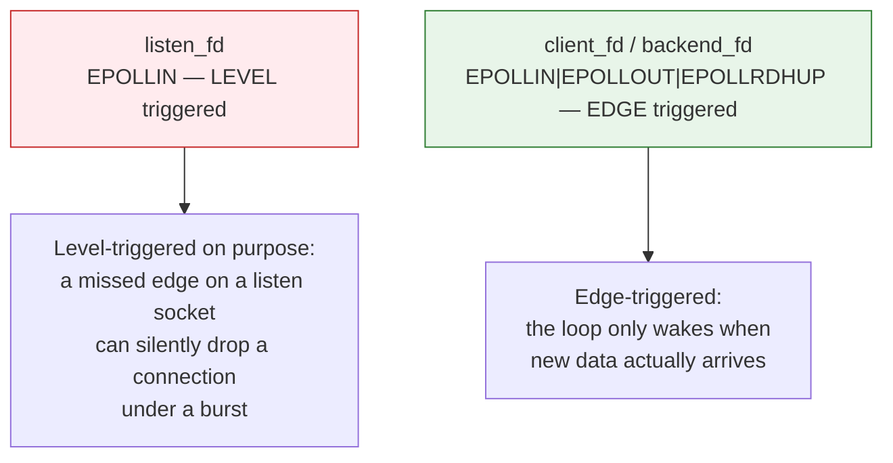

Every data socket is **edge-triggered** (`EPOLLET`). The contract that comes
with ET is: *you must read until `EAGAIN`*. The code honours this — the read
loop only exits on `EAGAIN`, on EOF, on error, or when the buffer fills up.

The listen socket is the exception. With ET, if the worker's `epoll_wait()`
returns and a wake-up is missed, a pending connection can sit in the accept
queue unnoticed. Level-triggered semantics make that impossible: the socket
stays readable and the worker is told again.

### The event dispatch

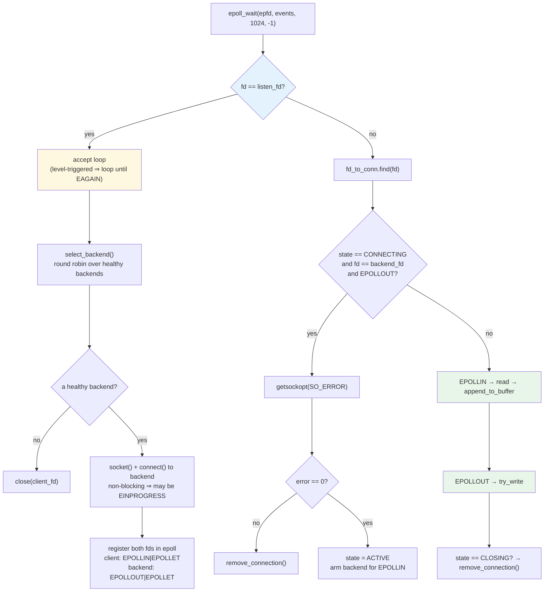

---

## 6. The connection state machine

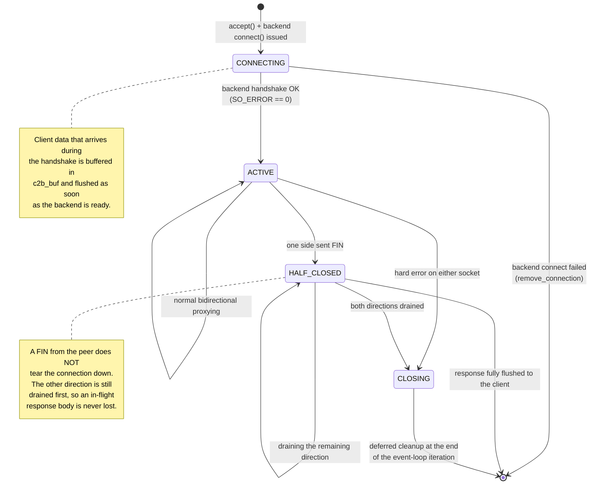

### Why the states exist at all

A TCP connection has **two** independent halves. `close()` kills both. The
naive proxy therefore breaks this common case:

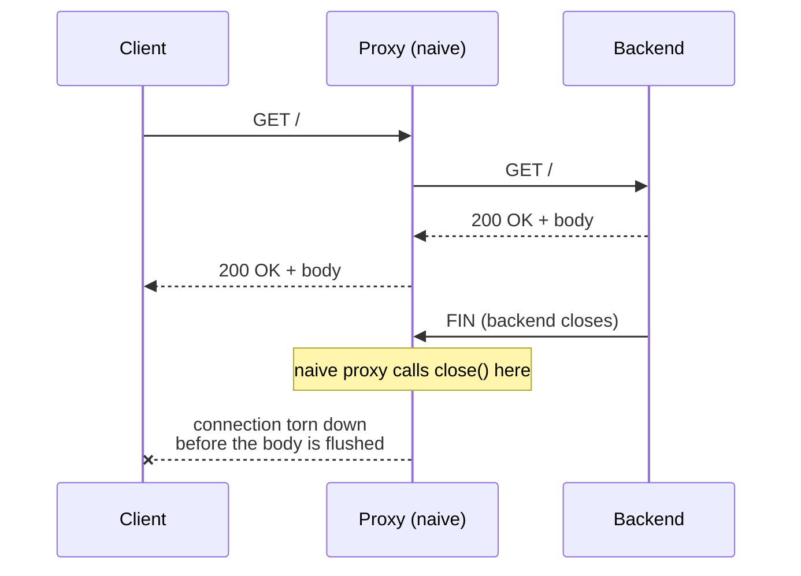

`cppbalancer` tracks the two halves separately with `client_eof` and
`backend_eof`, and only tears the connection down once **both** directions
are finished.

---

## 7. Buffers and the two data directions

Every `Connection` owns two fixed-size buffers and one epoll interest mask
per socket:

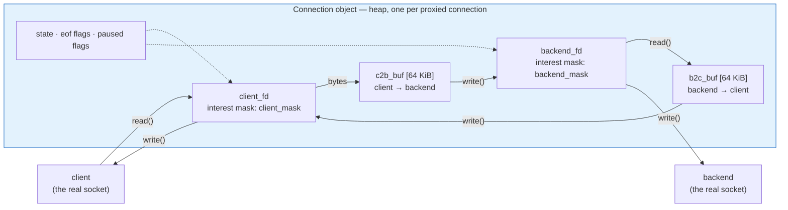

The two directions are handled by **the same code**:

| | client → backend | backend → client |
|---|---|---|
| Buffer | `c2b_buf` | `b2c_buf` |
| Source socket | `client_fd` | `backend_fd` |
| Destination socket | `backend_fd` | `client_fd` |
| Source of truth for "full" | `c2b_end == BUFFER_SIZE` | `b2c_end == BUFFER_SIZE` |

`append_to_buffer(fd, …)` and `try_write(fd)` are deliberately symmetric —
one function handles both directions, which halves the surface area for bugs.
The `fd == client_fd ? … : …` test inside them is the only place the two
directions differ.

### `EPOLLOUT` is armed only when there is something to write

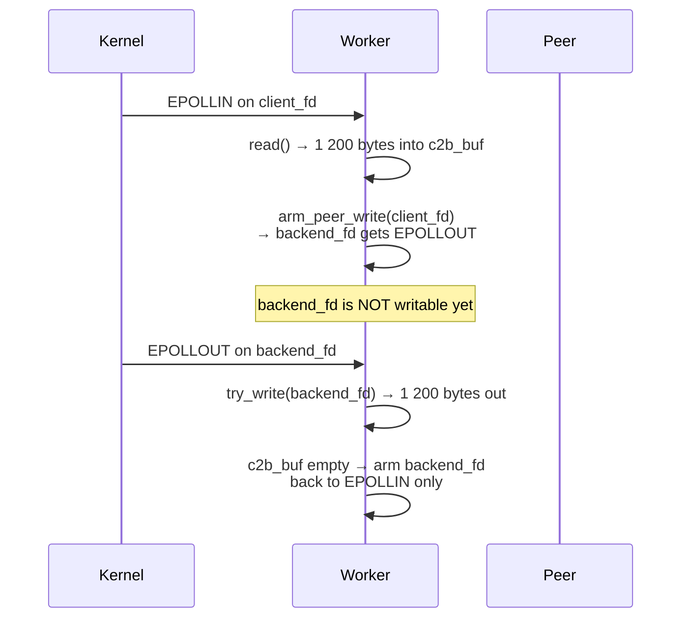

This keeps the epoll set minimal: a socket is only interested in writability
while there is genuinely buffered data waiting for it.

---

## 8. Backpressure — the pause/resume mechanism

This is the part of the design that guarantees the balancer never corrupts a
stream.

### The problem

The obvious implementation reads greedily into a fixed buffer and clamps what
does not fit:

```cpp
// WRONG — the surplus is silently discarded
size_t space = BUFFER_SIZE - c2b_end;
if (n > space) n = space;
memcpy(c2b_buf + c2b_end, data, n);
```

With `BUFFER_SIZE = 65536`, any response larger than 64 KiB loses its tail.
The client then waits forever for the `Content-Length` it was promised.

### The solution

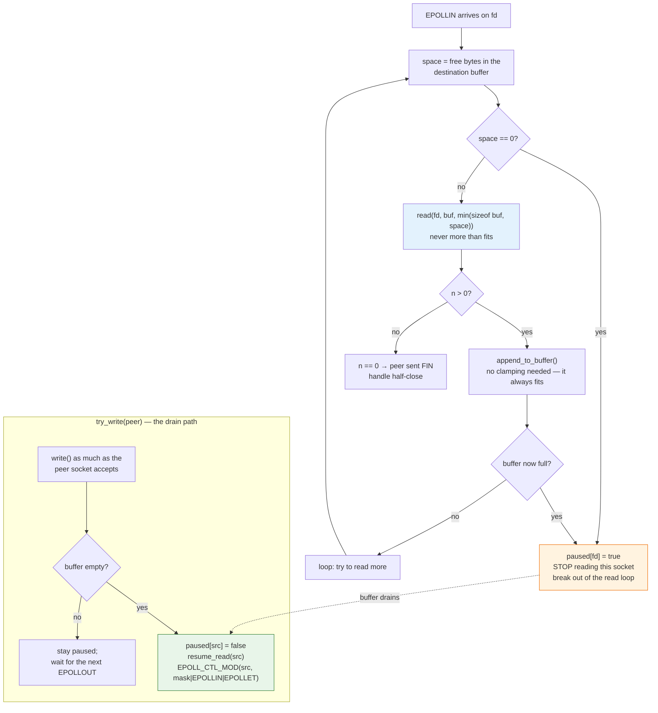

### The three ingredients

1. **Never read more than fits.**
   ```cpp
   size_t space = conn->space_for(fd);
   if (space == 0) { conn->set_paused(fd, true); break; }
   ssize_t n = read(fd, buffer, (sizeof(buffer) < space) ? sizeof(buffer) : space);
   ```
   A byte is never read unless there is a place to put it. Truncation becomes
   structurally impossible.

2. **Pause instead of spin.** When the buffer is full the read loop breaks and
   the socket stops being drained. The bytes stay in the kernel's socket
   receive buffer, where they are safe.

3. **Resume when the peer has drained the buffer.** `try_write()` is the only
   place a buffer shrinks, so it is the natural place to resume the reader:
   ```cpp
   if (*start >= *end) {                       // buffer fully drained
       *start = *end = 0;
       int src = (fd == backend_fd) ? client_fd : backend_fd;
       if (is_paused(src)) {
           set_paused(src, false);
           resume_read(src);                   // EPOLL_CTL_MOD with EPOLLIN re-added
       }
   }
   ```

### Why the interest mask has to be tracked

`resume_read()` re-arms the *source* socket with `EPOLL_CTL_MOD`. If it
naively wrote `EPOLLIN | EPOLLET`, it would **clear a pending `EPOLLOUT`** on
that socket — and the socket might have been holding bytes destined for the
other direction. So each socket's current mask is remembered:

```cpp
uint32_t client_mask  = EPOLLIN | EPOLLET;
uint32_t backend_mask = EPOLLOUT | EPOLLET;

void arm(int fd, uint32_t mask) {
    epoll_event e{}; e.events = mask; e.data.fd = fd;
    epoll_ctl(epfd, EPOLL_CTL_MOD, fd, &e);
    if (fd == client_fd) client_mask = mask; else backend_mask = mask;
}

void resume_read(int fd) {
    uint32_t mask = (fd == client_fd) ? client_mask : backend_mask;
    arm(fd, mask | EPOLLIN | EPOLLET);        // adds EPOLLIN, keeps EPOLLOUT
}
```

### A note on edge-triggered re-arming

`epoll_ctl(EPOLL_CTL_MOD)` re-checks the socket's readiness, so data that is
already sitting in the kernel's receive buffer is reported again. That is
what makes the pause/resume cycle work with `EPOLLET`.

### Deadlock freedom

Could both buffers fill at once and wedge the connection? No:

* `c2b_buf` full → the backend socket is armed for `EPOLLOUT` → the data is
  written to the backend → `c2b_buf` drains → the client is resumed.
* `b2c_buf` full → the client socket is armed for `EPOLLOUT` → the data is
  written to the client → `b2c_buf` drains → the backend is resumed.

Each full buffer always has a peer write pending, and that write is what
unblocks it.

---

## 9. A complete request, end to end

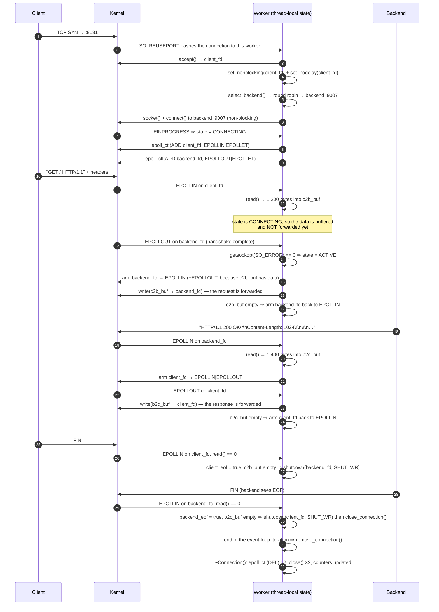

Notice the **asymmetry during `CONNECTING`**: the client can send data before
the backend handshake has finished. That data is buffered in `c2b_buf` and
flushed the moment the backend becomes ready — the client never waits for a
round trip it did not need to wait for.

---

## 10. Half-close handling

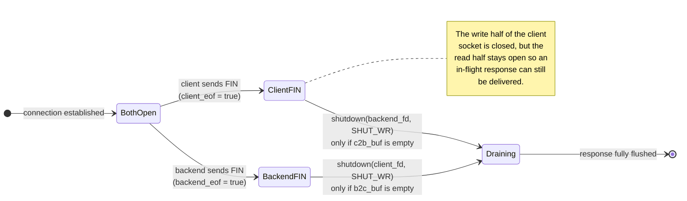

The rules, in code:

```cpp
if (n == 0) {                       // peer sent FIN
    if (fd == conn->client_fd) {
        conn->client_eof = true;
        if (conn->c2b_end == conn->c2b_start)      // nothing pending → propagate
            shutdown(conn->backend_fd, SHUT_WR);
    } else {
        conn->backend_eof = true;
        if (conn->b2c_end == conn->b2c_start) {
            shutdown(conn->client_fd, SHUT_WR);
            conn->close_connection();
        }
    }
}
```

A `FIN` is only propagated **once the data buffered in that direction has
been flushed**. Propagating it earlier would truncate a response that is
still in flight.

---

## 11. Backend selection: round robin

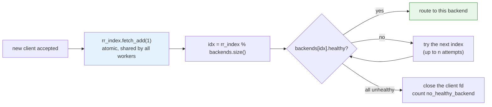

`rr_index` is a single `std::atomic<size_t>` shared by every worker, so the
rotation is global rather than per-thread — the traffic is spread evenly
across the pool instead of each worker favouring its own "next" backend.

Because the increment happens on every attempt, a backend that is
unhealthy is simply skipped over; the rotation still advances.

> **Measured:** 122 / 121 / 121 requests over three backends out of 364 —
> exact. See [benchmark §7.8](../benchmark/README.md#78-s8--s10--correctness-integrity-and-distribution).

---

## 12. Health checking and failover

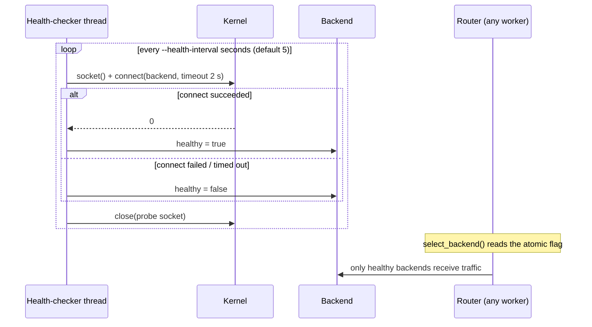

The probe is a **real TCP connect**, not a `ping`. It exercises the same path
a real request would take, so it detects a backend that is up but not
serving, a firewall that has started dropping packets, and a host that has
gone away — all the same way.

`healthy` and `active_connections` are `std::atomic`, so the health checker
can flip them from one thread while the workers read them from another,
with no lock.

**Measured:** killing one of three backends cost **0 req/s**
(42,195 → 44,240). Killing a second one also cost nothing. See
[benchmark §7.9](../benchmark/README.md#79-s9--backend-failure-and-failover).

---

## 13. Memory model and thread safety

| Object | Owner | Access | Synchronisation |
|---|---|---|---|
| `backends` (vector) | `main` | written once before the workers start; read-only afterwards | safe by construction (happens-before via `thread` creation) |
| `Backend::healthy` | health-checker **writes**, workers **read** | `std::atomic<bool>` | lock-free, `seq_cst` |
| `Backend::active_connections` | workers | `std::atomic<int>` | lock-free |
| `rr_index` | **all workers** increment | `std::atomic<size_t>` | lock-free, `relaxed` |
| `g_ctr` (counters) | **all workers** increment | `std::atomic<uint64_t>` | lock-free, `relaxed` |
| `fd_to_conn` map | **one worker only** | `thread_local` | needs none |
| `Connection` object | **one worker only** | heap-allocated, owned by the worker | needs none |
| `g_log_mutex` | all workers (logging only) | `std::mutex` | only on the logging path, skipped entirely with `--quiet` |

**The rule: a connection is never touched by two threads.** A worker accepts
a client, picks a backend, and then owns both file descriptors for the rest
of that connection's life — including closing them. There is no fd-ownership
hand-off, no work queue and no atomic reference counting on the hot path.

The only shared mutable state is a handful of atomics, and none of them sit
in the per-byte path.

---

## 14. Configuration

| Option | Environment variable | Default | Effect |
|---|---|---|---|
| `--listen-port <port>` | `CPPBALANCER_LISTEN_PORT` | `8181` | Port every worker binds with `SO_REUSEPORT`. |
| `--backends <ip:port,…>` | `CPPBALANCER_BACKENDS` | `127.0.0.1:9007,127.0.0.1:9003,127.0.0.1:6789` | The backend pool. A bare `port` means `127.0.0.1`. |
| `--workers <n>` | `CPPBALANCER_WORKERS` | `hardware_concurrency()` | Number of worker threads. `0` or unset ⇒ one per logical CPU. |
| `--health-interval <sec>` | `CPPBALANCER_HEALTH_INTERVAL` | `5` | Seconds between health-probe rounds. |
| `--quiet` | `CPPBALANCER_QUIET=1` | off | Suppress the per-connection log lines. |

Command-line options override environment variables. The defaults reproduce
the original hard-coded behaviour exactly, so the change is non-breaking.

> **Sizing the worker pool:** use the number of *physical* cores available to
> the balancer, and leave headroom for the backends. On the 2-physical-core
> benchmark machine, 2 workers beat 4 — the extra two landed on SMT siblings
> that share execution units with the workers already running.

---

## 15. Failure modes and how they are handled

| Failure | Detection | Reaction |
|---|---|---|
| **Backend is down** | health-checker's `connect()` probe fails | `healthy = false`; the router skips it. Measured cost: **0 req/s**. |
| **Backend dies mid-connection** | `read()` on `backend_fd` returns `0` or `EPIPE` | `backend_eof = true`; the client socket is shut down for writing and the connection is closed. The client sees a truncated response — unavoidable without retrying the request. |
| **Backend handshake fails** | `getsockopt(SO_ERROR)` after `EPOLLOUT` | `remove_connection()`; both sockets are closed. |
| **Client disappears** | `read()` on `client_fd` returns `0` | `client_eof = true`; the backend socket is shut down for writing so the backend can stop working. |
| **All backends unhealthy** | `select_backend()` returns `nullptr` | The client fd is closed and `no_healthy_backend` is incremented. |
| **Write to a peer fails** | `write()` returns an error other than `EAGAIN` | `close_connection()`; the connection is torn down at the end of the event-loop iteration. |
| **Backend is slow** | the destination buffer fills | **Backpressure**: reading is paused, the client is not read from, and the kernel's socket buffer applies the rest of the pressure. No data is lost. |
| **Signal / `EINTR`** | `epoll_wait()` returns `-1` with `errno == EINTR` | The loop simply continues. |

---

## 16. Cost model — where the time goes

For every request the balancer performs, relative to talking to the backend
directly:


**Four extra syscalls and two extra kernel TCP state machines per request**
(red boxes) — that is the entire intrinsic cost of a user-space TCP proxy.

The measured price on the benchmark machine:

| | direct | through the proxy |
|---|---|---|
| Throughput | 95,831 req/s | 44,862 req/s (**47 %**) |
| CPU per request | — | **42 µs** (1.89 cores at peak) |
| Added p50 latency | — | **+0.058 ms** |
| Added p99 latency | — | +0.125 ms |

The ~42 µs is dominated by the four extra syscalls and the two extra wakeups
(epoll returns, context switches). It does **not** grow with the number of
connections — the per-event overhead amortises as the epoll batch size grows,
which is why a single connection is the *least* efficient case
(50.1 µs/request at 1 connection vs 42.0 µs at 100).

For large payloads the cost per request scales linearly with the size,
because every 64 KiB chunk costs an extra `read`/`write` pair through user
space — see [benchmark §7.6](../benchmark/README.md#76-s6--payload-size-sweep-50-connections-2-wrk-threads).

---

## See also

* [`../README.md`](../README.md) — overview, build instructions, benchmark headline
* [`../benchmark/README.md`](../benchmark/README.md) — full benchmark methodology, environment and results
* [`../test/README.md`](../test/README.md) — interactive smoke tests
* [`../archive/README.md`](../archive/README.md) — the superseded single-threaded design and how it differs